# Home Server

Microservices-based home server running on Docker Compose with a full observability stack, CI/CD pipeline, and shared libraries.

## Architecture

```mermaid
graph TB
    %% ── External Layer ──────────────────────────────────
    subgraph EXTERNAL["☁️ External"]
        USER["👤 User / Browser"]
        PORTFOLIO_FE["🌐 Portfolio 2.0\n(React Frontend)"]
        GMAIL["📧 Gmail SMTP"]
    end

    %% ── CI/CD Pipeline ──────────────────────────────────
    subgraph CICD["🔄 CI/CD Pipeline"]
        GH["GitHub\n(release/1.0 · master)"]
        GHA["GitHub Actions\nRunner"]
        TS["Tailscale VPN\nMesh Network"]
        SSH["SSH Deploy\ngit pull → docker compose up"]
    end

    GH -->|push trigger| GHA
    GHA -->|connect| TS
    TS -->|secure tunnel| SSH
    SSH -->|deploys to| DOCKER

    %% ── Docker Compose Stack ────────────────────────────
    subgraph DOCKER["🐳 Docker Compose · home-server-network (bridge)"]

        %% ── Reverse Proxy ───────────────────────────────
        NGINX["🔒 Nginx\nReverse Proxy\n:80"]

        %% ── API Gateway ─────────────────────────────────
        subgraph GW["⚡ API Gateway · :3000"]
            GATEWAY["Express.js\n+ http-proxy-middleware"]
            RL["Rate Limiter"]
            CORS_MW["CORS"]
            GW_METRICS["Metrics Middleware\n(Prometheus)"]
        end

        %% ── Microservices ───────────────────────────────
        subgraph SERVICES["📦 Microservices"]
            AUTH["🔐 Auth Service\n:3001\n/api/v1/auth"]
            USERS["👥 Users Service\n:3002\n/api/v1/users"]
            PRODUCTS["🛍️ Products Service\n:3003\n/api/v1/products"]
            ORDERS["📋 Orders Service\n:3004\n/api/v1/orders"]
            PORTFOLIO_BE["💼 Portfolio Backend\n:8002\n/api/v1/portfolio"]
        end

        %% ── Data Layer ──────────────────────────────────
        subgraph DATA["💾 Data Layer"]
            REDIS["🔴 Redis 7 Alpine\n:6379\nAOF Persistence"]
            REDIS_VOL[("redis-data\nvolume")]
        end

        %% ── Shared Libraries ────────────────────────────
        subgraph SHARED["📚 Shared Libraries"]
            LIB_AUTH["auth\n(JWT · bcrypt)"]
            LIB_REDIS["redis\n(client)"]
            LIB_LOGGER["logger"]
            LIB_DB["database"]
            LIB_UTILS["utils"]
        end

        %% ── Monitoring & Observability ──────────────────
        subgraph MONITORING["📊 Monitoring & Observability"]
            PROM["🔍 Prometheus\n:9090\n30d retention"]
            GRAFANA["📈 Grafana\n:3008\nDashboards"]
            ALERTMGR["🔔 Alertmanager\n:9093\nEmail Alerts"]
            REDIS_EXP["📡 Redis Exporter\n:9121"]
            PROM_VOL[("prometheus-data\nvolume")]
            GRAFANA_VOL[("grafana-data\nvolume")]
            ALERTMGR_VOL[("alertmanager-data\nvolume")]
        end
    end

    %% ── Traffic Flow ────────────────────────────────────
    USER -->|HTTPS| NGINX
    PORTFOLIO_FE -->|API calls & beacons| NGINX
    NGINX -->|proxy_pass| GATEWAY

    GATEWAY -->|/api/v1/auth| AUTH
    GATEWAY -->|/api/v1/users| USERS
    GATEWAY -->|/api/v1/products| PRODUCTS
    GATEWAY -->|/api/v1/orders| ORDERS
    GATEWAY -->|/api/v1/portfolio| PORTFOLIO_BE

    %% ── Data Connections ────────────────────────────────
    PORTFOLIO_BE -->|visitor data & cache| REDIS
    REDIS --- REDIS_VOL

    %% ── Email Notifications ─────────────────────────────
    PORTFOLIO_BE -->|visitor email alerts| GMAIL
    ALERTMGR -->|alert emails| GMAIL

    %% ── Shared Library Usage ────────────────────────────
    AUTH -.->|imports| LIB_AUTH
    AUTH -.->|imports| LIB_REDIS
    USERS -.->|imports| LIB_AUTH
    USERS -.->|imports| LIB_DB
    PRODUCTS -.->|imports| LIB_DB
    ORDERS -.->|imports| LIB_DB
    PORTFOLIO_BE -.->|imports| LIB_REDIS
    GATEWAY -.->|imports| LIB_LOGGER

    %% ── Metrics Scraping ────────────────────────────────
    PROM -->|scrape /metrics| GATEWAY
    PROM -->|scrape /metrics| PORTFOLIO_BE
    PROM -->|scrape /metrics| REDIS_EXP
    PROM -->|self-monitor| PROM
    REDIS_EXP -->|reads metrics| REDIS

    %% ── Monitoring Data Flow ────────────────────────────
    PROM -->|datasource| GRAFANA
    PROM -->|alert rules| ALERTMGR
    PROM --- PROM_VOL
    GRAFANA --- GRAFANA_VOL
    ALERTMGR --- ALERTMGR_VOL

    %% ── Styles ──────────────────────────────────────────
    classDef external fill:#1a1a2e,stroke:#e94560,color:#fff
    classDef gateway fill:#0f3460,stroke:#16213e,color:#fff
    classDef service fill:#533483,stroke:#2b2d42,color:#fff
    classDef data fill:#b55400,stroke:#e85d04,color:#fff
    classDef monitoring fill:#006d77,stroke:#83c5be,color:#fff
    classDef shared fill:#2d6a4f,stroke:#40916c,color:#fff
    classDef cicd fill:#7b2cbf,stroke:#9d4edd,color:#fff
    classDef volume fill:#495057,stroke:#6c757d,color:#fff

    class USER,PORTFOLIO_FE,GMAIL external
    class GATEWAY,RL,CORS_MW,GW_METRICS gateway
    class NGINX gateway
    class AUTH,USERS,PRODUCTS,ORDERS,PORTFOLIO_BE service
    class REDIS data
    class PROM,GRAFANA,ALERTMGR,REDIS_EXP monitoring
    class LIB_AUTH,LIB_REDIS,LIB_LOGGER,LIB_DB,LIB_UTILS shared
    class GH,GHA,TS,SSH cicd
    class REDIS_VOL,PROM_VOL,GRAFANA_VOL,ALERTMGR_VOL volume
```



## Structure

| Directory | Description |
|---|---|
| `gateway/` | API Gateway — Express.js with rate limiting, CORS, proxy routing, Prometheus metrics |
| `services/auth-service/` | Authentication & authorization (JWT, password hashing) |
| `services/users-service/` | User management |
| `services/products-service/` | Product catalog |
| `services/orders-service/` | Order processing |
| `services/portfolio-backend/` | Portfolio API — skills, visitor tracking, email notifications |
| `Portfolio-2.0/` | React frontend for the portfolio site |
| `shared/` | Shared libraries — auth, redis, logger, database, utils |
| `infrastructure/nginx/` | Nginx reverse proxy configuration |
| `infrastructure/prometheus/` | Prometheus config & alert rules |
| `infrastructure/grafana/` | Grafana dashboard provisioning |
| `infrastructure/alertmanager/` | Alertmanager config & email templates |
| `.github/workflows/` | CI/CD — GitHub Actions deploy via Tailscale + SSH |
| `docs/` | Documentation |

## Getting Started

```bash
docker-compose up -d
```

## Observability (OpenTelemetry, industry-standard baseline)

This stack implements OpenTelemetry as the standard for **traces, metrics, and logs** with OTLP transport, semantic resource attributes, and a collector-based pipeline:

- **Instrumentation**: Node.js services preload OpenTelemetry SDK auto-instrumentation (HTTP/Express/Redis, etc.), propagate context, and export telemetry via OTLP.
- **Collector (`otel-collector`)**: receives OTLP on `:4317` (gRPC) / `:4318` (HTTP), applies `memory_limiter`, `resource` normalization, sensitive-attribute redaction, trace sampling, and `batch` processing, then routes signals to backends.
- **Traces**: exported to **Grafana Tempo** (OTLP) for storage/query; Grafana is provisioned with Tempo and trace↔log/metric correlations.
- **Metrics**: OTel metrics are exported through the collector Prometheus exporter (`:8889`) and scraped by Prometheus; existing app `/metrics` endpoints (gateway, portfolio-backend) remain for current dashboards/alerts compatibility.
- **Logs**: application/console logs are emitted as OTLP log records with trace/span correlation and exported to **Grafana Loki** (OTLP HTTP ingest) for centralized querying and trace correlation.
- **Configuration**: services use `OTEL_SERVICE_NAME`, `OTEL_EXPORTER_OTLP_ENDPOINT`, `OTEL_SERVICE_NAMESPACE`, and `OTEL_RESOURCE_ATTRIBUTES` for consistent resource identity and environment tagging.
- **Operational hardening (recommended for non-local exposure)**: enable TLS/mTLS and authentication on OTLP receivers/exporters, tune sampling/retention, and add stricter PII redaction/transforms per data policy.

## Ports

| Service | Port |
|---|---|
| Nginx | `:80` |
| API Gateway | `:3000` |
| Auth Service | `:3001` |
| Users Service | `:3002` |
| Products Service | `:3003` |
| Orders Service | `:3004` |
| Portfolio Backend | `:8002` |
| Redis | `:6379` |
| Prometheus | `:9090` |
| Grafana | `:3008` |
| Alertmanager | `:9093` |
| Redis Exporter | `:9121` |
| OpenTelemetry Collector (OTLP gRPC) | `:4317` |
| OpenTelemetry Collector (OTLP HTTP) | `:4318` |
| OpenTelemetry Collector (Prometheus metrics) | `:8889` |
| OpenTelemetry Collector (health) | `:13133` |
| Tempo (query/API) | `:3200` |
| Loki (API) | `:3100` |


